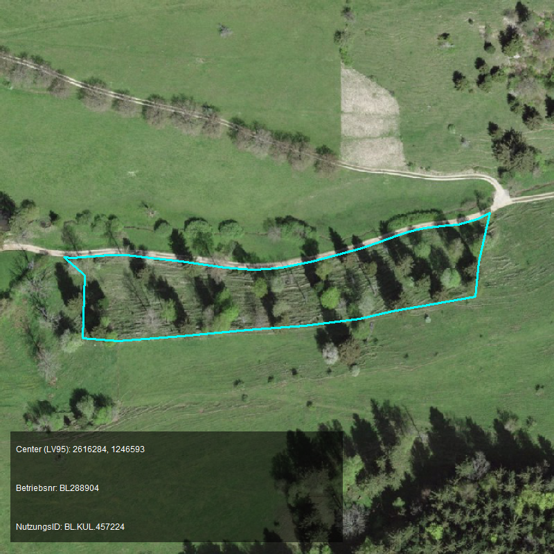
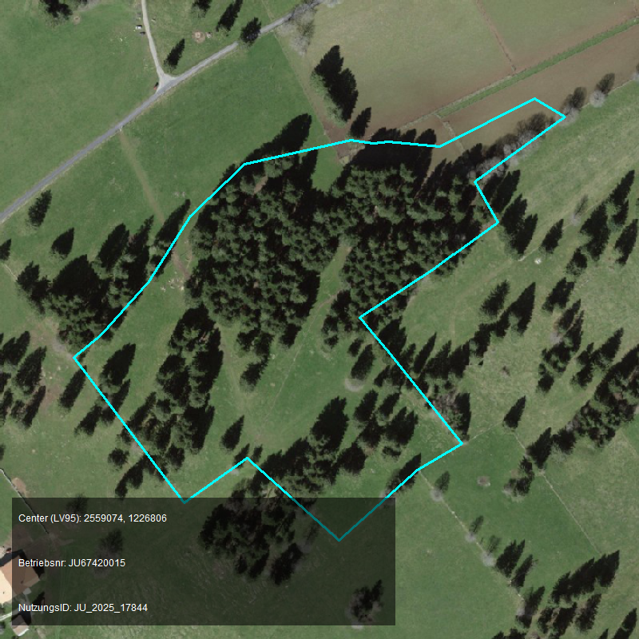
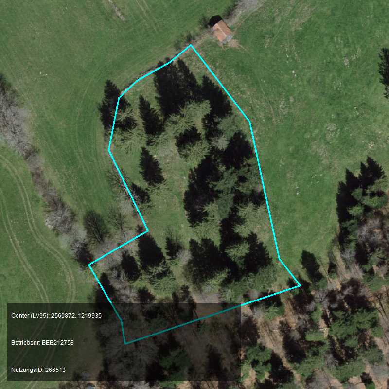

Als Datengrundlage wurden folgende vier wichtige Datensammlungen identifiziert:
Vegetationshöhenmodell, Geobasisdaten Landwirtschaftliche Kulturflächen, SWISSIMAGE und swissSURFACE3D.
Ergänzend werden in @sec-wald die verfügbaren Geodaten zum Wald beschrieben, welche für die Abgrenzung zwischen Wald und landwirtschaftlicher Nutzfläche sowie für den Umgang mit Waldweiden relevant sind.

## Vegetationshöhenmodell (VHM)

Ein Produkt, welches von der WSL bereitgestellt wird und anzeigt, wie hoch die Vegetation auf einer bestimmten Fläche ist.
Hat eine Auflösung von 1 × 1 m und wird alle sechs Jahre aus Luftbildern und alle sechs Jahre (um drei Jahre versetzt) aus LIDAR-Scans gerechnet.
Siehe: [Vegetationshöhenmodell LFI](https://opendata.swiss/de/dataset/vegetationshohenmodell-lfi) und [Vegetationshöhenmodell Lidar LFI](https://opendata.swiss/de/dataset/vegetationshohenmodell-lidar-lfi).

::: {#fig-vhm}
```{=html}
<iframe 
    src="https://map.geo.admin.ch/#/embed?lang=de&center=2727300,1271000&z=9&topic=ech&layers=ch.bafu.landesforstinventar-vegetationshoehenmodell_lidar@,,1"
    width="100%" 
    height="500px"
    style="border: 1pt solid black;"
    allow="geolocation" 
    allowfullscreen>
</iframe>
```
Interaktive Ansicht des Vegetationshöhenmodell Lidar LFI der Vergation rund um Weerswilen TG.
:::

## Geobasisdaten Landwirtschaftliche Kulturflächen

Die landwirtschaftlichen Geodaten basieren auf dem minimalen Geodatenmodell gemäss der Modelldokumentation "Landwirtschaftliche Kulturflächen" [@blw2026mgdm].
Dieses Modell strukturiert die landwirtschaftlichen Kulturflächen in verschiedene Informationsebenen (Layers), welche die minimalen Anforderungen an Struktur und Detaillierungsgrad für den Geodatenaustausch zwischen Bund und Kantonen definieren.
Beschrieben sind fünf Layer, wobei vier davon für dieses Projekt von Relevanz sind:

- [153.1 Nutzungsflächen](@sec-153.1)
- [153.3 Biodiversitätsförderflächen Qualitätsstufe II und Vernetzung](@sec-153.3)
- [153.5 Perimeter Landwirtschaftliche Nutzfläche und Sömmerungsflächen](@sec-153.5)
- [153.6 Bewirtschaftungseinheiten](@sec-153.6)

Diese Layers werden in den folgenden Unterkapiteln im Detail beschrieben.[^1]

[^1]: Die Reihenfolge wurde gewählt, um den Lesefluss zu verbessern und entspricht daher nicht der Reihenfolge der Identifikatoren.

### Bewirtschaftungseinheiten {#sec-153.6}

Das Modell "153.6 Bewirtschaftungseinheiten" beschreibt die Flächen, welche von einem bestimmten Betrieb (Ganzjahres- oder Sömmerungsbetrieb) zugeordnet sind Zur Identifikation des Betriebs wird die Betriebsnummer aus AGIS verwendet.
Zusätzlich beinhaltet dieser Layer die Produktionsstätten. "Als Als Produktionsstätte gilt eine Einheit von Land, Gebäuden und Einrichtungen, die räumlich als solche erkennbar und getrennt von anderen Produktionsstätten ist" [@blw2026mgdm, Seite 35].
Die Summe aller Bewirtschaftungseinheiten eines Betriebes ergibt dessen gesamte Betriebsfläche beziehungsweise den Alpperimeter im Sömmerungsgebiet.
Diese Ebene dient als räumliche Grundlage und Erfassungshilfe für die detaillierteren Nutzungsflächen.

### Perimeter Landwirtschaftliche Nutzfläche und Sömmerungsflächen {#sec-153.5}

Das Modell "153.5 Perimeter Landwirtschaftliche Nutzfläche und Sömmerungsflächen" stellt die potenziell landwirtschaftlich zu bewirtschaftende Fläche nach [Art. 14 LBV](https://www.fedlex.admin.ch/eli/cc/1999/13/de#art_14) dar.
Die Ebene dient ebenfalls als Erfassungshilfe für die Nutzungsflächen.
Der Layer stellt die potentiell landwirtschaftlich bewirtschaftbaren Flächen dar. Dabei interessiert vor allem die Abgrenzung (Perimeter) dieser 
Flächen.
Der Perimeter der Landwirtschaftliche Nutzfläche und Sömmerungsflächen wird von den Kantonen festgelegt und periodisch aktua
lisiert.
Als Grundlage zur Erstellung dieser Flächen dient primär die Bodenbedeckung der Amtlichen Vermessung.
Die Polygone in diesem Layer können Lücken oder Löcher aufweisen und decken die Schweiz nicht vollständig ab [@blw2026mgdm, Seite 15].

### Nutzungsflächen {#sec-153.1}

Das Modell "153.1 Nutzungsflächen" beschreib die Nutzungsflächen selbst, also die effektiv landwirtschaftlich genutzten Flächen gemäss der Landwirtschaftlichen Begriffsverordnung (LBV) und der Direktzahlungsverordnung (DZV).
Jede Nutzungsfläche muss zwingend innerhalb einer zugeteilten Bewirtschaftungseinheit (153.6) liegen.
Die Geometrien sind als Multipolygone erfasst und mit einem spezifischen Nutzungscode (`LNF_Code`) versehen, welche die Hauptkultur auf dieser Fläche in einem bestimmten Jahr identifiziert.
Bäume können in diesem Modell zusätzlich als überlagernde Flächen geometrisch erfasst werden, wobei die Anzahl der Bäume im Attribut `Anzahl_Baeume` als Zahl angehängt wird.
Dieses Attribut ist jedoch optional und wird daher nicht von allen Kantonen erfasst.

::: {#fig-vhm}
```{=html}
<iframe 
    src="https://map.geo.admin.ch/#/embed?lang=de&center=2727300,1271000&z=9&topic=ech&layers=ch.bafu.landesforstinventar-vegetationshoehenmodell_lidar@,t,1;ch.blw.landwirtschaftliche-nutzungsflaechen@,t,0.6"
    width="100%" 
    height="500px"
    style="border: 1pt solid black;"
    allow="geolocation" 
    allowfullscreen>
</iframe>
```
Interaktive Ansicht des Vegetationshöhenmodell Lidar LFI mit darübergelegter Karte der landwirtschaftlichen Nutzungsflächen (Geobasisdaten 153.1) der Vergation rund um Weerswilen TG. Obstanlagen sind hier gut ersichtlich, da hochwachsende Vegetation innerhalb der Nutzungsflächen liegt.
:::

Für das Projekt Boschettissimo sind die Nutzungsflächen besonderes relevant, da die Direktzahlungsbeiträge auf diesen Flächen basieren.

### Biodiversitätsförderflächen Qualitätsstufe II und Vernetzung {#sec-153.3}

Dieses Modell überlagert die Ebene der Nutzungsflächen und beschreibt spezifisch diejenigen Elemente, für welche Bundesbeiträge bezüglich biologischer Qualität und Vernetzung ausgerichtet werden.
Der Layer ist in zwei separate Ebenen gegliedert (Qualitätsstufe II und Vernetzung), welche sich auch gegenseitig überlagern können.
Die Flächen in diesem Modell sind grösstenteils eine Untermenge der Biodiversitätsförderflächen der Qualitätsstufe I aus dem Layer 153.1.
Ausnahmen bilden beispielsweise Hochstamm-Feldobstbäume (QII) oder artenreiche Grün- und Streueflächen im Sömmerungsgebiet.
Sie weisen keine direkte datentechnische Verknüpfung zu den Bewirtschaftungseinheiten auf; der Bezug zum Betrieb wird stattdessen durch einen räumlichen Flächenverschnitt mit den anderen Layern hergestellt.

## Daten zum Wald {#sec-wald}

Für die Abgrenzung von Bäumen auf der landwirtschaftlichen Nutzfläche gegenüber dem Wald sowie für den Umgang mit Waldweiden ist es wichtig zu wissen, welche Geodaten zum Wald existieren, wo sie bezogen werden können und wie sie sich unterscheiden.
Im folgenden Unterkapitel sind die wichtigsten Erkenntnisse zu Datensammlungen zum Wald mit Relevanz für dieses Projekt zusammengetragen.

Die wichtigste Erkenntnis vorweg: Es gibt keinen einzelnen, schweizweit einheitlichen und zugleich rechtlich verbindlichen GIS-Layer «Wald».
Stattdessen existieren mehrere Produkte, die den Wald unterschiedlich definieren, unterschiedliche Geometrietypen aufweisen und die Schweiz unterschiedlich vollständig abdecken.

### Statische Waldgrenzen {#sec-waldgrenzen}

Statische Waldgrenzen werden auf der Grundlage rechtskräftiger Waldfeststellungen festgelegt und in den Nutzungsplänen eingetragen; neue Bestockungen ausserhalb dieser Waldgrenzen gelten nicht als Wald [Art. 13 @wag].
Eine Waldfeststellung ist nur dort vorgeschrieben, wo Bauzonen an den Wald grenzen oder wo der Kanton eine Zunahme des Waldes verhindern will [Art. 10 Abs. 2 @wag].
Statische Waldgrenzen decken deshalb nicht den gesamten Wald ab, sondern nur dessen Grenze gegenüber bestimmten Zonen.
Die Daten basieren auf dem minimalen Geodatenmodell «Statische Waldgrenzen» (Identifikator 157.1, Version 1.2) [@geodienste_waldgrenzen].
Die Nachführung liegt in der Verantwortung der Kantone, unter Oberaufsicht des Bundesamts für Umwelt (BAFU).

Für dieses Projekt sind zwei Eigenschaften entscheidend:
Erstens enthält der Datensatz überwiegend Linien (Grenzverläufe) und keine flächendeckenden Polygone.
Einzelne Kantone sind daran, den Wald zusätzlich als Polygone zu erfassen; je nach Kanton liegen deshalb Linien oder Polygone vor.
Zweitens sind die Daten nicht für alle Kantone vollständig verfügbar (siehe @sec-wald-bezug).

### Bodenbedeckung «Wald» im swissTLM3D {#sec-tlm-wald}

Das swissTLM3D ist das digitale topografische Landschaftsmodell der Schweiz von swisstopo [@swisstopo].
Es beinhaltet flächendeckende Vektordaten, unter anderem die Ebene der Bodenbedeckung (`TLM_BODENBEDECKUNG`), in welcher der Wald als Polygone abgebildet ist.
Unterschieden werden folgende bestockte Objektarten [@swisstopo2026ok, Kapitel 7.1]:

| Code | Objektart     | Definition |
|:-----|:--------------|:-----------|
| `6`  | Gebüschwald   | Mit gleich- oder verschiedenartigen Sträuchern dicht bestockte Fläche (hölzerne Pflanzen, welche sich bereits am Boden verästeln). |
| `12` | Wald          | Eine bewaldete Fläche, die mit gleich- oder verschiedenartigen Bäumen dicht bestockt ist. |
| `13` | Wald offen    | Eine wenig dicht bewaldete Fläche mit einer Bodenvegetation. |
| `14` | Gehölzfläche  | Kleinere Flächen mit Baum- und Strauchbeständen, häufig entlang von Strassen und Gewässern. Isolierte Waldflächen werden ebenfalls als Gehölzflächen erfasst, wenn sie die definierten Mindestgrössen des Waldes oder Gebüschwaldes nicht erreichen (Mindestgrösse 200 m^2^, Mindestlänge 25 m). |

: Bestockte Objektarten der Bodenbedeckung im swissTLM3D {#tbl-tlm-bodenbedeckung tbl-colwidths="[5,20,75]"}

Der Wald im swissTLM3D ist rein topografisch definiert.
Er basiert primär auf der Auswertung von Luftbildern und zeigt die physische Bestockung, also wo in der Realität eine geschlossene Baumbedeckung sichtbar ist.

::: {.callout-important}
Die topografischen Waldpolygone des swissTLM3D sind rechtlich nicht verbindlich.
Sie spiegeln nicht den juristischen Waldbegriff gemäss Waldgesetz wider.
Eine frisch gerodete oder durch Sturm zerstörte Fläche kann rechtlich weiterhin Wald sein, im swissTLM3D aber vorübergehend fehlen.
Umgekehrt können baumbestockte Flächen im swissTLM3D als Wald erfasst sein, die juristisch (noch) nicht als Wald gelten.
:::

Der Datensatz wird von swisstopo für die ganze Schweiz nach einem einheitlichen Modell erstellt.
Die Kartierung der Waldflächen ist inhaltlich jedoch heterogen: Im Mittelland ist sie gut brauchbar, im Berggebiet ist insbesondere die Objektart «Wald offen» sehr uneinheitlich erfasst.

::: {#fig-tlm-wald}
```{=html}
<iframe 
    src="https://map.geo.admin.ch/#/embed?lang=de&center=2559074,1226806&z=10&topic=ech&layers=ch.swisstopo.swisstlm3d-wald@,t,0.7;ch.blw.landwirtschaftliche-nutzungsflaechen@,t,0.6"
    width="100%" 
    height="500px"
    style="border: 1pt solid black;"
    allow="geolocation" 
    allowfullscreen>
</iframe>
```
Interaktive Ansicht der Waldflächen gemäss swissTLM3D mit darübergelegter Karte der landwirtschaftlichen Nutzungsflächen (Geobasisdaten 153.1) rund um eine Waldweide im Kanton Jura.
:::

### Waldreservate {#sec-waldreservate}

Als spezifisch ausgeschiedene Flächen geschützt sind nur die Waldreservate (Naturwaldreservate und Sonderwaldreservate), die der Erhaltung der Artenvielfalt von Fauna und Flora dienen.
In diesen Polygonen ist die Bewirtschaftung stark eingeschränkt oder vollständig untersagt.
Die geschützten Wälder sind gemäss Wiener Resolution 4, Anhang 2, der Ministerkonferenz zum Schutz der Wälder in Europa klassiert.
Die Daten basieren auf dem minimalen Geodatenmodell «Waldreservate» (Identifikator 160.1, Versionen 1.1 und 2.0) und sind als Polygone für alle Kantone auf geodienste.ch publiziert [@geodienste_waldreservate].
Für die Abgrenzung von Wald und landwirtschaftlicher Nutzfläche sind sie nicht geeignet, da sie nur einen kleinen Teil des Waldes umfassen.

### Waldmaske des LFI {#sec-waldmaske-lfi}

Zusätzlich existiert eine Waldmaske aus dem Schweizerischen Landesforstinventar (LFI) [@lfi], die vollständig automatisch generiert wurde.
Dabei wurden Obstanlagen, die sehr nahe am Wald liegen, ebenfalls als Wald klassiert.
Für die Erkennung von Bäumen auf landwirtschaftlichen Flächen ist dies ein wesentlicher Nachteil, da gerade solche Obstanlagen für das Projekt relevant sind.

### Rechtlicher Waldbegriff {#sec-waldbegriff}

Gemäss Waldgesetz ist der Wald in der Schweiz grundsätzlich und flächendeckend geschützt: «Das Waldareal soll nicht geschmälert werden» [@wag, Art. 3].
Rodungen sind verboten und nur ausnahmsweise mit Bewilligung möglich [@wag, Art. 5]; für Rodungen ist in der Regel in derselben Gegend Realersatz zu leisten [@wag, Art. 7].
Der Schutz ist damit dynamisch: Wächst der Wald natürlich in die Fläche, wird auch der neue Baumbestand zu rechtlich geschütztem Wald (sofern keine statische Waldgrenze festgelegt ist).
Wird der Wald durch ein Naturereignis wie Sturm oder Waldbrand zerstört, bleibt die Fläche rechtlich trotzdem Wald.
Nach Verständnis des Projektteams ist damit primär die Gesamtfläche des Waldes geschützt, nicht zwingend für immer dasselbe Polygon.
Ein rechtlich verbindlicher, flächendeckender Wald-Layer existiert deshalb nicht: Die statischen Waldgrenzen sind der einzige rechtlich verbindliche Datensatz, und dieser ist weder flächendeckend noch für alle Kantone vollständig.

### Bezug der Daten {#sec-wald-bezug}

| Datensatz | Geometrie | Bezugsquelle | Abdeckung (Stand Oktober 2026) |
|:----------|:----------|:-------------|:-------------------------------|
| Statische Waldgrenzen (157.1) | überwiegend Linien, teilweise Polygone | [geodienste.ch](https://geodienste.ch/services/npl_waldgrenzen) | Nicht für alle Kantone vollständig: BE, FR, GR, SO und TI sind als unvollständig gekennzeichnet; für NW, OW und VD ist eine Freigabe erforderlich. |
| Bodenbedeckung swissTLM3D | Polygone | [swisstopo](https://www.swisstopo.admin.ch/de/landschaftsmodell-swisstlm3d) | Ganze Schweiz, einheitliches Modell |
| Waldreservate (160.1) | Polygone | [geodienste.ch](https://geodienste.ch/services/waldreservate) | Alle Kantone vollständig, Modellversionen 1.1 und 2.0 gemischt |
| Waldmaske LFI | nicht abgeklärt | WSL | Ganze Schweiz |

: Bezugsquellen und Abdeckung der Wald-Datensätze {#tbl-wald-bezug tbl-colwidths="[20,20,20,40]"}

Auf geodienste.ch sind neben den statischen Waldgrenzen auch die Waldreservate publiziert.
Die Metadaten zu den statischen Waldgrenzen sind zudem auf [geocat.ch](https://www.geocat.ch/datahub/dataset/04c4bff9-28e7-41a9-875d-590c41387099) beschrieben.

### Unterschiede zwischen den Kantonen {#sec-wald-kantone}

Der swissTLM3D-Datensatz wird zentral von swisstopo erstellt und liegt damit für die ganze Schweiz nach demselben Modell vor; regionale Unterschiede bestehen in der Kartierqualität (siehe @sec-tlm-wald).
Die statischen Waldgrenzen hingegen werden von den Kantonen erfasst und unterscheiden sich in Verfügbarkeit, Vollständigkeit, Geometrietyp (Linien oder Polygone) und Nutzungsbedingungen.
Auch bei den Waldreservaten liefern die Kantone ihre Daten in unterschiedlichen Modellversionen.

### Waldweiden {#sec-waldweiden}

Als Waldweiden gelten die bestockten Weiden (Wytweiden) nach Artikel 2 der Waldverordnung [@lbv, Art. 19 Abs. 4].
Bestockte Weiden sind «Flächen, auf denen Waldbestockungen und offene Weideplätze mosaikartig abwechseln und die sowohl der Vieh- als auch der Forstwirtschaft dienen» [@wav, Art. 2 Abs. 2].
Waldweiden sind damit per Definition Flächen, auf denen sich landwirtschaftliche Nutzung und Wald überlagern: Die Weidefläche gilt als landwirtschaftliche Nutzfläche, die Bäume gehören zum Wald.
Beispiele solcher Flächen zeigt @fig-waldweiden.

In den Nutzungsflächen (siehe @sec-153.1) werden Waldweiden mit zwei Nutzungscodes erfasst, beide in der Gruppe «Dauergrünflächen – Dauerweiden» [@blw2026mgdm]:

| LNF-Code | Bezeichnung | Biodiversitätsförderfläche |
|:---------|:------------|:---------------------------|
| `618` | Waldweiden (ohne bewaldete Fläche) | BFF Qualitätsstufe I |
| `625` | Waldweiden (ohne bewaldete Fläche) | keine |

: Nutzungscodes für Waldweiden gemäss Modell 153.1 {#tbl-waldweiden-codes tbl-colwidths="[20,40,40]"}

Der Zusatz «ohne bewaldete Fläche» geht auf die ursprüngliche Erfassung der Waldweiden zurück: Damals wurden die einzelnen Bäume mittels Radar- beziehungsweise Luftbildaufnahmen erfasst und pro Baum eine bestimmte Fläche von der Gesamtfläche abgezogen.
Im heutigen Datenmodell wird die Bestockung über das Attribut `Bewirtschaftungsgrad` berücksichtigt, mit dem beispielsweise bei einer Waldweide (618) nur 75 % der Fläche als bewirtschaftet angerechnet werden [@blw2026mgdm, Kapitel 6.4.1].
Die erfasste Geometrie entspricht also der gesamten Weidefläche inklusive Bäume; die Bestockung selbst ist in der Regel nicht geometrisch, sondern nur als Prozentwert abgebildet.

#### Überlappung mit der LN

Waldweiden liegen zu einem grossen Teil ausserhalb der landwirtschaftlichen Nutzfläche (LN).
Im Jahr 2025 umfassten die Nutzungsflächen mit den Codes 618 und 625 insgesamt 17'577 ha.
Davon lagen 9'410 ha innerhalb der LN; die übrigen 8'167 ha (rund 46 %) lagen ausserhalb der LN, also im Wesentlichen im Sömmerungsgebiet.

#### Überlappung mit dem Wald

Waldweiden überlappen mit Sicherheit mit Waldflächen, da sie per Definition bestockt sind (siehe @fig-waldweiden).
Wie gross die Überlappung ist, wurde noch nicht quantifiziert.
Die Antwort hängt davon ab, welcher Wald-Datensatz als Referenz dient:

- Mit den Polygonen des swissTLM3D lässt sich die Überschneidung einfach per Verschnitt berechnen.
- Mit den statischen Waldgrenzen ist dies nur dort möglich, wo Polygone vorliegen; andernfalls müssten Durchschneidungen von Polygonen mit Linien analysiert werden, was deutlich aufwändiger ist.

::: {#fig-waldweiden layout-ncol=3}

{#fig-waldweide-bl}

{#fig-waldweide-ju}

{#fig-waldweide-be}

Beispiele von Waldweiden (Nutzungscodes 618 und 625) in drei Kantonen auf dem Luftbild. Die cyanfarbene Linie zeigt die Abgrenzung der erfassten Nutzungsfläche gemäss Geobasisdaten 153.1. Innerhalb der Fläche wechseln sich Baumgruppen und offene Weideplätze mosaikartig ab; die Bestockung ist in der Geometrie nicht ausgeschieden.
:::

### Folgerungen für das Projekt {#sec-wald-folgerungen}

- Da eine schweizweite Lösung benötigt wird, kommt zurzeit nur der swissTLM3D als Wald-Referenz in Frage, sowohl für ein mögliches Baum-Beitragssystem als auch für die Analysen in der Machbarkeitsstudie. Die Vor- und Nachteile des swissTLM3D im Rahmen eines Beitragssystems sind noch zu beschreiben; auch die Analyse von Gewinnern und Verlierern eines neuen Systems soll auf dem swissTLM3D basieren.
- Ergänzend könnte für einen Kanton mit vollständigen statischen Waldgrenzen ein Vergleich zwischen swissTLM3D und statischer Waldgrenze gerechnet werden. Mögliche zukünftige Alternativen zum swissTLM3D können im Schlussbericht beschrieben werden.
- Offen ist der Umgang mit Flächen, die faktisch Waldweiden sind (also viele Bäume aufweisen), aber nicht mit den Codes 618 oder 625 deklariert wurden. Ein möglicher Ansatz ist ein Verschnitt pro Kultur (LNF-Code) und Kanton, der zeigt, wie viel swissTLM3D-Waldfläche in jeder Nutzungsflächenart liegt.
- Vermutlich sind die meisten Waldweiden mit Nadelbäumen bestockt. Da das angestrebte System nur Laubbäume berücksichtigt, ist die Frage der Waldweiden für das Projekt möglicherweise weniger relevant als zunächst angenommen.

Die offenen Punkte zu Waldflächen und Waldweiden sind zudem im Kapitel «Bekannte Probleme» aufgeführt.

## SWISSIMAGE

Das Orthofoto SWISSIMAGE ist eine Zusammensetzung der neuen digitalen Farbluftbilder über die ganze Schweiz mit einer Bodenauflösung von 10 cm im Flachland und den wichtigsten Alpentälern sowie 25 cm in den Alpen.
Es wird in einem Nachführungszyklus von drei Jahren seit 2018 aktualisiert, wobei jeweils um drei Jahre versetzt alle sechs Jahre Bäume belaubt und unbelaubt fotografiert werden. 

## swissSURFACE3D

Beschreibt die Oberfläche der Schweiz mit allen natürlichen und künstlichen Elementen in Form einer klassifizierten Punktwolke.
Die mit einem airborne LiDAR erhobenen Daten zeichnen sich durch eine hohe Punktdichte und Genauigkeit aus. swissSURFACE3D wird in Kacheln von jeweils 1 km^2^ produziert.
Die Kachelnummerierung entspricht den Kilometerkoor-dinaten des südwestlichen Eckpunkts einer Kachel.
